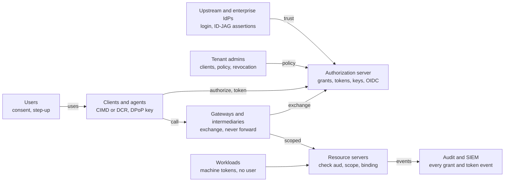

# Modern OAuth 2.1 authorization server: problems and requirements

Oct 17, 2026 · @JJ

See the [Go implementation plan](docs/implementation-plan.md) for the proposed architecture, delivery phases and verification strategy, and the [requirement delivery matrix](docs/requirement-matrix.md) for coverage of every requirement below.

Engineering follows [AGENTS.md](AGENTS.md), the [canonical repository structure](docs/repository-structure.md), and the [dependency license policy](docs/dependency-policy.md). CI checks architecture boundaries, license evidence, formatting, tests and static analysis. Run `go run ./tools/checks`, `go test -race ./...` and `go vet ./...` locally with the pinned Go toolchain.

The [ports-and-adapters CI rules](docs/architecture-enforcement.md) define the enforced boundaries and their limits. Run `go run ./tools/checks -only architecture` to check architecture independently.

P0 is complete: [the protocol-spike report](docs/p0/protocol-spike.md) records Fosite selection, real PostgreSQL transactions and OpenBao Transit signing. The [P1 foundation and runbook](docs/p1-foundation.md) add a standalone process, external PostgreSQL configuration, explicit migrations/provisioning, isolated tenant management, key publication/rotation and audit/outbox delivery. Start a disposable two-tenant stack with `go run ./tools/p0 -development`. Login, consent and usable OAuth/OIDC endpoints remain P2; this foundation is not a production authorization server or full README conformance claim.

P2 implementation is in progress: [core authorization milestones](docs/p2-core-authorization.md). Durable consent, configured upstream OIDC login and browser sessions/consent are implemented as a limited preview. Live token endpoints, resource enforcement and usable end-to-end OAuth integration remain under development.

## The problems

A platform that lets users, third-party clients and AI agents act on its resources needs one authorization server that solves eight separate problems. Each is independent: solving one does not solve the others.

1. **Ambient authority.** A login session is valid everywhere. Any token handed to a lower-trust client (an agent, a desktop app, a partner integration) is a full-account credential, so its theft is an account takeover. Tokens must be bound to one resource and a subset of the user's permissions.
2. **Unknown clients.** Agents and tools connect without prior registration. The server must identify a client it has never seen, decide whether to trust it, and show the user who is asking.
3. **Consent that means something.** A user must grant a specific client specific access to a specific resource, see and revoke that grant later, and have the revoke take effect at once.
4. **Delegation across hops.** A request often passes through a gateway or agent chain before reaching the system of record. The user's identity and the chain of actors must survive every hop, each hop may only narrow access, and no intermediary may become a super-user.
5. **Enterprise control.** Organisations want their identity provider and admins, not each user, to decide which apps and agents may reach which resources, and to cut access off centrally.
6. **Identity for relying parties.** Other applications want to sign users in with this platform (it acts as an OpenID Provider) and also to accept users from upstream identity providers (it acts as a relying party).
7. **Stolen tokens.** Bearer tokens are copied from logs, configs, browsers and proxies. Tokens need short lives, revocation, and binding to the holder's key so a copy is useless elsewhere.
8. **Machines and workloads.** Services, scheduled jobs and gateways need their own identities, ideally without long-lived shared secrets, and their tokens must stay distinguishable from user tokens.

## Actors and trust boundaries

The authorization server is the only issuer. Clients and agents get user tokens through consent or an enterprise assertion; gateways exchange those for narrower tokens; workloads get machine tokens; every resource server accepts only tokens whose audience is itself, and every event goes to audit. The requirement groups below follow these arrows: CLI and CORE for the client, FED for the IdPs, DEL for gateways, RES and BIND for resource servers, M2M for workloads, ADM for admins and audit.

## Core flows and grants

The server implements OAuth 2.1 (draft-ietf-oauth-v2-1, still an Internet-Draft at -15) and removes everything 2.1 deprecates. Levels below use MUST, SHOULD and MAY as in RFC 2119.

| ID | Requirement | Level | Standard | Verified |
| --- | --- | --- | --- | --- |
| CORE-1 | Authorization code grant with PKCE for every client, public and confidential; `S256` only, `plain` refused | MUST | OAuth 2.1, RFC 7636 |  |
| CORE-2 | Implicit grant and resource owner password grant not offered | MUST | OAuth 2.1 |  |
| CORE-3 | Redirect URIs compared by exact string match; no wildcards, no partial paths | MUST | OAuth 2.1, RFC 9700 |  |
| CORE-4 | Loopback redirects on any port and private-use URI schemes for native apps; claimed `https` redirects preferred | MUST | RFC 8252 |  |
| CORE-5 | Authorization codes single-use, bound to client, redirect URI and PKCE challenge, lifetime of at most 60 seconds; a reused code revokes every token issued from it | MUST | OAuth 2.1, RFC 9700 |  |
| CORE-6 | Refresh token grant with rotation for public clients, or sender-binding (DPoP or mTLS) | MUST | OAuth 2.1 |  |
| CORE-7 | Client credentials grant for confidential machine clients | MUST | RFC 6749 |  |
| CORE-8 | Token exchange grant | MUST | RFC 8693 |  |
| CORE-9 | JWT bearer authorization grant (assertion in exchange for a token) | MUST | RFC 7523 |  |
| CORE-10 | Device authorization grant for input-constrained clients (CLIs, TVs, headless agents) | SHOULD | RFC 8628 |  |
| CORE-11 | Client-Initiated Backchannel Authentication, for out-of-band approval of an agent's request on the user's phone | MAY | OpenID CIBA Core |  |
| CORE-12 | Bearer tokens accepted only in the `Authorization` header, never in query strings | MUST | RFC 6750, OAuth 2.1 |  |
| CORE-13 | Errors returned in the standard error format, with `WWW-Authenticate` challenges carrying `error`, `scope` and `resource_metadata` | MUST | RFC 6750, RFC 9728 |  |

## Discovery and metadata

A client that has never seen the server must find every endpoint and capability from one URL.

| ID | Requirement | Level | Standard | Verified |
| --- | --- | --- | --- | --- |
| DISC-1 | Authorization server metadata at `/.well-known/oauth-authorization-server`, including path-based issuers for multiple issuers on one host | MUST | RFC 8414 |  |
| DISC-2 | OpenID Provider configuration at `/.well-known/openid-configuration`, consistent with DISC-1 | MUST | OpenID Connect Discovery 1.0 |  |
| DISC-3 | Protected resource metadata for every resource it protects, naming the authorization servers, scopes and token binding methods it accepts; resource servers return its URL in `WWW-Authenticate` | MUST | RFC 9728 |  |
| DISC-4 | `iss` returned on every authorization response, and clients told so via `authorization_response_iss_parameter_supported`, to stop mix-up attacks | MUST | RFC 9207 |  |
| DISC-5 | Metadata advertises every supported grant, auth method, code challenge method, DPoP algorithm, scope, claim and `client_id_metadata_document_supported` | MUST | RFC 8414, CIMD draft |  |
| DISC-6 | Signed metadata (`signed_metadata`) for deployments that need tamper evidence | MAY | RFC 8414 §2.1 |  |
| DISC-7 | Metadata advertises supported authorization grant profiles, for MCP Enterprise-Managed Authorization | SHOULD | MCP 2026-07-28 |  |
| DISC-8 | Metadata never advertises a capability the server does not enforce (for example scopes it ignores) | MUST | Operational rule |  |

## Client identity and registration

A client becomes known in one of three ways (metadata document, dynamic registration, admin registration) and proves its identity in one of five (private key JWT, mTLS, secret, attestation, or none for public clients).

| ID | Requirement | Level | Standard | Verified |
| --- | --- | --- | --- | --- |
| CLI-1 | Client ID Metadata Documents: an `https` URL is the `client_id`; the server fetches the JSON document it names, validates it and caches it with the document's cache headers | MUST | draft-ietf-oauth-client-id-metadata-document (-02), MCP 2026-07-28 |  |
| CLI-2 | CIMD fetches are SSRF-safe: `https` only, no private or link-local addresses, no redirects to other hosts, size and time limits, the document's `client_id` equal to its URL | MUST | CIMD draft security considerations |  |
| CLI-3 | Redirect URIs in a CIMD document checked against the document's origin policy; the consent screen shows the client's verified host, not only its self-declared name | MUST | CIMD draft |  |
| CLI-4 | Dynamic client registration, with optional initial access tokens to restrict who may register | MUST | RFC 7591 |  |
| CLI-5 | Registration management (read, update, delete) with registration access tokens | SHOULD | RFC 7592 |  |
| CLI-6 | Software statements: signed client metadata from a trusted publisher, verified on registration | MAY | RFC 7591 §2.3 |  |
| CLI-7 | Pre-registered clients managed by administrators | MUST | RFC 6749 |  |
| CLI-8 | Client authentication by `private_key_jwt`, with keys from a JWKS URL or inline JWKS (including keys published in a CIMD document) | MUST | RFC 7523, OIDC Core §9 |  |
| CLI-9 | Client authentication by mutual TLS, PKI and self-signed variants | SHOULD | RFC 8705 |  |
| CLI-10 | Client authentication by `client_secret_basic` for legacy confidential clients; secrets stored hashed and rotatable with overlap | MUST | RFC 6749 |  |
| CLI-11 | Public clients (`none`) allowed only with PKCE and either refresh rotation or DPoP | MUST | OAuth 2.1 |  |
| CLI-12 | `application_type` (web or native) honoured to choose redirect rules | SHOULD | OIDC Registration, MCP 2026-07-28 |  |
| CLI-13 | Attestation-based client authentication for mobile and desktop apps that can prove their build | MAY | draft-ietf-oauth-attestation-based-client-auth |  |
| CLI-14 | Per-tenant client policy: allow any client, allowlisted CIMD hosts only, or admin-approved clients only | MUST | Operational |  |

## Resource binding and access tokens

This is the fix for ambient authority: every access token names the one resource it is for, and that resource refuses all others.

| ID | Requirement | Level | Standard | Verified |
| --- | --- | --- | --- | --- |
| RES-1 | Resource indicators accepted on authorize and token requests; the issued token's `aud` is exactly the requested resource | MUST | RFC 8707 |  |
| RES-2 | Resources are registered objects with their own URI, scope catalog, token lifetime and allowed clients; unknown resources refused with `invalid_target` | MUST | RFC 8707 |  |
| RES-3 | Clients that send no `resource` are bound by the authorization endpoint path they used, or by a per-resource issuer, never left unbound | MUST | Defence for clients without RFC 8707 support |  |
| RES-4 | One resource per access token; multi-resource requests return one token per resource via refresh | SHOULD | RFC 8707 §2.2 |  |
| RES-5 | JWT access tokens in the JWT profile: `typ` = `at+jwt`, `iss`, `sub`, `aud`, `exp`, `iat`, `jti`, `client_id`, `scope`, plus `auth_time` and `acr` when known | MUST | RFC 9068 |  |
| RES-6 | Opaque access tokens as a per-resource option, for resources that must see revocation instantly through introspection | SHOULD | RFC 7662 |  |
| RES-7 | Machine tokens carry `sub` equal to `client_id` and no user claims, so a resource can always tell user tokens from machine tokens | MUST | RFC 9068 §2.2 |  |
| RES-8 | Tenant identity (organisation) in a dedicated claim, never inferred from the user | MUST | Operational |  |
| RES-9 | A token issued for one resource is refused by every other resource, including other resources served by the same platform | MUST | RFC 8707, RFC 9068 §4 |  |
| RES-10 | Rich authorization requests using standard `authorization_details`, including grants limited to specific objects/actions (for example document `123`, read only); prerequisite for the P2 core preview | MUST | RFC 9396 |  |

## Scopes, consent and grants

A grant is a durable record: this user lets this client do these things on this resource, until it expires or is revoked. Tokens are derived from grants and never outlive them. [ADR 0010](docs/adr/0010-rar-object-grants-prerequisite.md) makes RFC 9396 object-specific grants a mandatory P2 prerequisite; a scope-only preview does not satisfy RES-10.

| ID | Requirement | Level | Standard | Verified |
| --- | --- | --- | --- | --- |
| GRANT-1 | Scopes defined per resource, with human descriptions shown on consent; requests for unknown scopes refused with `invalid_scope` | MUST | RFC 6749 §3.3 |  |
| GRANT-2 | Effective access = the user's current permissions ∩ the approved scope and RAR object/action ceilings, evaluated at the resource on every request; historical token claims cannot restore permissions the user has lost | MUST | Design rule |  |
| GRANT-3 | Explicit consent screen per client, resource and scope set, showing the client's verified identity and redirect host; protected against clickjacking (`frame-ancestors 'none'`) and CSRF | MUST | RFC 9700 §4.4, §4.7 |  |
| GRANT-4 | Consent stored as a grant record with client, user, tenant, resource, scopes, authorization details, created, expires, revoked | MUST | Design rule |  |
| GRANT-5 | Incremental authorization: a client asks for more scopes later, and the new consent extends the existing grant instead of replacing it | SHOULD | OAuth 2.1, RFC 9470 for the challenge |  |
| GRANT-6 | Down-scoping on refresh and exchange: scopes and RAR object/action permissions may only narrow, never gain new objects or actions | MUST | RFC 6749 §6, RFC 8693, RFC 9396 |  |
| GRANT-7 | Users list and revoke their own grants; tenant admins list and revoke any grant in their tenant | MUST | Design rule |  |
| GRANT-8 | Grant management API for clients to query, update and revoke the grant they hold | MAY | FAPI Grant Management |  |
| GRANT-9 | Revoking a grant revokes every token derived from it, including tokens exchanged from it at any depth, and refresh token families | MUST | Design rule, RFC 7009 |  |
| GRANT-10 | Admin-defined policy: maximum grant lifetime, scopes that always need admin approval, clients that may not be granted access | MUST | Operational |  |
| GRANT-11 | Admin consent: an administrator grants a client access for every user in a tenant, so users see no prompt | SHOULD | Enterprise practice, ID-JAG flows |  |
| GRANT-12 | Consent skipped only for first-party clients the tenant marked trusted; that list is explicit and audited | MUST | RFC 9700 |  |

## Token lifecycle

Short-lived access tokens, rotating refresh tokens, and revocation that reaches resource servers fast enough to matter.

| ID | Requirement | Level | Standard | Verified |
| --- | --- | --- | --- | --- |
| LIFE-1 | Access token lifetime configurable per resource and per client; default 5 to 15 minutes | MUST | RFC 9700 §4.14 |  |
| LIFE-2 | Refresh tokens opaque, stored hashed, rotated on every use; reuse of a rotated token revokes the whole family and its grant | MUST | OAuth 2.1 §4.3, RFC 9700 §4.14.2 |  |
| LIFE-3 | Refresh tokens have an idle timeout and an absolute lifetime, both capped by tenant policy | MUST | RFC 9700 |  |
| LIFE-4 | Revocation endpoint for access and refresh tokens, authenticated for confidential clients | MUST | RFC 7009 |  |
| LIFE-5 | Introspection endpoint for resource servers, authenticated, returning `active` plus the token's claims | MUST | RFC 7662 |  |
| LIFE-6 | Signed JWT introspection responses for resources that must prove what they were told | MAY | RFC 9701 |  |
| LIFE-7 | Revoked access token `jti`s pushed to resource servers or published as a denylist until the token's expiry | SHOULD | Design rule |  |
| LIFE-8 | Security event push for revocations and session ends (Shared Signals Framework, CAEP `session-revoked` and `token-claims-change`) | SHOULD | OpenID SSF 1.0, CAEP |  |
| LIFE-9 | Global revocation of every token for a user or a client, for incident response | MUST | draft-parecki-oauth-global-token-revocation |  |
| LIFE-10 | Signing keys published as JWKS with `kid`; new keys published before use and old keys kept for one maximum token lifetime | MUST | RFC 7517, RFC 8414 |  |
| LIFE-11 | Asymmetric signing only (ES256, EdDSA, PS256); `none` and HMAC refused for access and ID tokens | MUST | RFC 8725 |  |
| LIFE-12 | Every token has a `jti`, and the server can find every token derived from a grant, refresh family or parent token | MUST | Design rule for GRANT-9 |  |

## Sender-constrained tokens

A bound token is useless to whoever copies it, because each use needs a proof signed by the holder's key.

| ID | Requirement | Level | Standard | Verified |
| --- | --- | --- | --- | --- |
| BIND-1 | DPoP on the token endpoint and for resource access: access tokens carry `cnf.jkt`, refresh tokens of public clients bound to the same key | MUST | RFC 9449 |  |
| BIND-2 | DPoP proofs checked for `htm`, `htu`, `iat` window, `jti` replay, and `ath` hash of the access token | MUST | RFC 9449 §4.3 |  |
| BIND-3 | Server-supplied DPoP nonces (`DPoP-Nonce`, `use_dpop_nonce`) to limit pre-generated proofs | SHOULD | RFC 9449 §8, §9 |  |
| BIND-4 | Authorization code bound to the DPoP key at the authorize step (`dpop_jkt`) | SHOULD | RFC 9449 §10 |  |
| BIND-5 | Certificate-bound access tokens for mTLS clients (`cnf.x5t#S256`) | SHOULD | RFC 8705 |  |
| BIND-6 | Per-resource and per-client policy to require binding; a resource that requires it refuses bearer use of the same token | MUST | RFC 9449 §7, RFC 9728 `dpop_bound_access_tokens_required` |  |
| BIND-7 | Binding survives token exchange: an exchanged token is bound to the presenter's key, not the original subject's | MUST | RFC 8693 with RFC 9449 |  |

Limit to state plainly: script running inside the holder's page or process can still use a non-exportable key. Binding stops replay from elsewhere, not misuse on the holder's own device.

## Delegation and token exchange

When a request passes through a gateway or a chain of agents, each hop exchanges the token it received for a narrower one. The user stays the subject; the actors are recorded.

| ID | Requirement | Level | Standard | Verified |
| --- | --- | --- | --- | --- |
| DEL-1 | Token exchange with `subject_token` (the incoming token) and optional `actor_token` (the intermediary's own identity); the intermediary authenticates as a confidential client | MUST | RFC 8693 |  |
| DEL-2 | The exchanged token keeps `sub` = the original user and records the actors in the `act` claim: the current actor at the top level, earlier actors nested inside it | MUST | RFC 8693 §4.1 |  |
| DEL-3 | An exchange may only narrow: same user and tenant, scopes ⊆ the subject token's (or mapped through an admin-declared scope map), audience limited to resources the intermediary is declared to front | MUST | Design rule |  |
| DEL-4 | Delegation allowed only when declared: `may_act` in the subject token, or an admin-declared link between intermediary and target resource; no open-ended impersonation | MUST | RFC 8693 §4.4 |  |
| DEL-5 | Maximum chain depth and per-hop lifetime limits; an exchanged token never outlives its subject token | MUST | Design rule |  |
| DEL-6 | Exchange re-checks the grant behind the subject token, so a revoked grant cannot be exchanged | MUST | GRANT-9 |  |
| DEL-7 | Client credentials (no user) kept as a separate, explicit path for hops that act for no user, with tokens that never carry user claims | MUST | RFC 6749, RES-7 |  |
| DEL-8 | Transaction tokens for calls inside a trust domain: a short-lived, signed record of the caller, purpose and context, passed between internal services | SHOULD | draft-ietf-oauth-transaction-tokens (-08, in WG last call) |  |
| DEL-9 | Audit records link every exchanged token to its parent, so a full chain can be reconstructed | MUST | Design rule |  |
| DEL-10 | Agent identity: an agent acting on its own (not for a user) is a client with its own credentials and an audit trail, never a shared service account | MUST | Design rule |  |

## OpenID Connect provider

Other applications sign users in with this server, so it is also a full OpenID Provider.

| ID | Requirement | Level | Standard | Verified |
| --- | --- | --- | --- | --- |
| OIDC-1 | Authorization code flow with ID tokens; `nonce` required and checked; ID token `aud` = the client | MUST | OIDC Core 1.0 |  |
| OIDC-2 | ID tokens and access tokens are distinct: an ID token is never accepted as an access token | MUST | OIDC Core, RFC 9068 §4 |  |
| OIDC-3 | UserInfo endpoint; claims released only for granted scopes (`openid`, `profile`, `email`, `phone`, `address`, `offline_access`) and requested `claims` | MUST | OIDC Core §5 |  |
| OIDC-4 | `prompt` (`none`, `login`, `consent`, `select_account`), `max_age`, `auth_time`, `login_hint`, `acr_values` and `acr`/`amr` in tokens | MUST | OIDC Core §3.1.2.1 |  |
| OIDC-5 | Pairwise subject identifiers per client sector, as a per-client option | SHOULD | OIDC Core §8 |  |
| OIDC-6 | RP-initiated logout | MUST | OIDC RP-Initiated Logout 1.0 |  |
| OIDC-7 | Back-channel logout to every client that holds a session for the user | MUST | OIDC Back-Channel Logout 1.0 |  |
| OIDC-8 | Front-channel logout and session management iframe | MAY | OIDC Front-Channel Logout, Session Management (third-party cookie limits make these unreliable) |  |
| OIDC-9 | Account selection for users in several tenants, with the chosen tenant in tokens | MUST | Design rule |  |
| OIDC-10 | Identity claims verified before release (`email_verified`, `phone_number_verified`) | MUST | OIDC Core §5.1 |  |
| OIDC-11 | OpenID Provider certification for the basic, config and dynamic profiles | SHOULD | OpenID Certification |  |

## Federation and enterprise access

The server trusts upstream identity providers for login, and lets an enterprise identity provider decide which apps and agents reach which resources, with no consent prompt per user.

| ID | Requirement | Level | Standard | Verified |
| --- | --- | --- | --- | --- |
| FED-1 | Upstream OIDC identity providers for login (Okta, Entra ID, Google Workspace, and any compliant provider), configured per tenant, with discovery and JWKS fetching | MUST | OIDC Core, Discovery |  |
| FED-2 | Upstream SAML 2.0 identity providers for login | SHOULD | SAML 2.0 |  |
| FED-3 | Account linking keyed on (issuer, upstream `sub`), never on email alone; local `sub` stays stable across providers | MUST | Design rule |  |
| FED-4 | Home-realm discovery: route a user to their tenant's identity provider by email domain or tenant hint | SHOULD | Enterprise practice |  |
| FED-5 | Identity Assertion JWT Authorization Grant (ID-JAG): accept an ID-JAG signed by a trusted enterprise IdP via the JWT bearer grant, and issue an access token for the named resource without a consent screen | MUST | draft-ietf-oauth-identity-assertion-authz-grant (-04), RFC 7523 |  |
| FED-6 | ID-JAG checks: signature against the trusted IdP's JWKS; `typ`, `iss`, `aud` = this server, `client_id`, `resource`, `scope`, short `exp`; the subject mapped to a local user in the same tenant | MUST | ID-JAG draft |  |
| FED-7 | Act as the issuing side of ID-JAG when this server is the enterprise IdP: exchange a user's ID token or refresh token (RFC 8693) for an ID-JAG aimed at another authorization server, gated by admin policy | SHOULD | ID-JAG draft, RFC 8693 |  |
| FED-8 | Cross-App Access (XAA): the name ID-JAG-04 gives this pattern; supporting FED-5 to FED-7 is what XAA support means | MUST | ID-JAG draft -04 |  |
| FED-9 | MCP Enterprise-Managed Authorization, the MCP extension built on ID-JAG (stable since June 2026), including the grant profile metadata of DISC-7 | MUST | MCP ext-auth, MCP 2026-07-28 |  |
| FED-10 | JWT bearer grant for other trusted assertion issuers (a vault, another authorization server, a service mesh), each issuer configured with its JWKS, audience and allowed subjects | MUST | RFC 7523 |  |
| FED-11 | Token exchange accepting an upstream ID token or access token as `subject_token`, for enterprise flows that do not use ID-JAG | SHOULD | RFC 8693 |  |
| FED-12 | SCIM provisioning and deprovisioning; deprovisioning a user revokes their grants and sessions | SHOULD | RFC 7643, RFC 7644 |  |
| FED-13 | OpenID Federation trust chains for large multi-party ecosystems | MAY | OpenID Federation 1.0 |  |

Naming caution: some products use "XAA" for any external authorization assertion under RFC 7523 (Authplane's docs do). Here XAA means the ID-JAG pattern, as the IETF draft defines it.

## Machine and workload identity

Services, jobs and gateways authenticate as themselves, preferably with platform-issued identities instead of long-lived shared secrets.

| ID | Requirement | Level | Standard | Verified |
| --- | --- | --- | --- | --- |
| M2M-1 | Client credentials grant for confidential clients, with `resource` and scope limits per client | MUST | RFC 6749 §4.4, RFC 8707 |  |
| M2M-2 | Workload identity federation: accept a Kubernetes service-account token, a cloud workload identity token (AWS, GCP, Azure) or a SPIFFE JWT-SVID as a client assertion, with no stored secret | SHOULD | RFC 7523, SPIFFE |  |
| M2M-3 | mTLS client authentication with workload certificates (SPIFFE X.509-SVID) | MAY | RFC 8705 |  |
| M2M-4 | Machine tokens identifiable on sight: `sub` = `client_id`, no user claims (RES-7) | MUST | RFC 9068 §2.2 |  |
| M2M-5 | Secrets, where unavoidable, generated by the server, shown once, stored hashed, rotatable with an overlap window, and expiring | MUST | Operational |  |
| M2M-6 | Per-client rate limits and anomaly alerts on token issuance volume | SHOULD | Operational |  |

## Security hardening

The OAuth 2.0 Security Best Current Practice (RFC 9700) is the baseline; FAPI 2.0 is the bar for high-value tenants.

| ID | Requirement | Level | Standard | Verified |
| --- | --- | --- | --- | --- |
| SEC-1 | Every recommendation of the OAuth Security BCP applied; deviations listed and justified | MUST | RFC 9700 |  |
| SEC-2 | Pushed authorization requests are required for every interactive authorization request, with client binding, immutable request contents and no direct front-channel bypass | MUST | RFC 9126 |  |
| SEC-3 | Signed request objects for clients that need integrity of authorization parameters | MAY | RFC 9101 |  |
| SEC-4 | JWT-secured authorization responses | MAY | OpenID JARM |  |
| SEC-5 | Step-up authentication: resources return `insufficient_user_authentication` with required `acr_values` or `max_age`, and the server re-authenticates (MFA) before issuing | MUST | RFC 9470 |  |
| SEC-6 | Mix-up defences: `iss` in responses (DISC-4) and distinct redirect URIs per authorization server on the client side | MUST | RFC 9207, RFC 9700 §4.4 |  |
| SEC-7 | No open redirectors: errors on invalid `client_id` or `redirect_uri` shown on the server, never redirected | MUST | RFC 9700 §4.11 |  |
| SEC-8 | `state` or PKCE-based CSRF protection, consent and login pages un-frameable, `Referrer-Policy: no-referrer` on pages that carry codes | MUST | RFC 9700 §4.2, §4.7 |  |
| SEC-9 | JWT handling per the JWT BCP: explicit `typ` per token kind, algorithm allowlist, no `jku`/`x5u` header following, audience always checked | MUST | RFC 8725 |  |
| SEC-10 | FAPI 2.0 Security Profile available per tenant: PAR, sender-constrained tokens, `private_key_jwt` or mTLS only | SHOULD | FAPI 2.0 Security Profile |  |
| SEC-11 | Brute-force and credential-stuffing limits on login, token and introspection endpoints, per IP, client and user | MUST | Operational |  |
| SEC-12 | External security review and a published threat model before production | MUST | Operational |  |

## Browser clients and sessions

The server's own login session, and browser apps that use it, are the most exposed credentials. Prefer a backend-for-frontend so the browser never holds tokens.

| ID | Requirement | Level | Standard | Verified |
| --- | --- | --- | --- | --- |
| WEB-1 | First-party browser apps use a backend-for-frontend: tokens held server-side, the browser holds only an `HttpOnly`, `Secure`, `SameSite`, `__Host-` session cookie | MUST | draft-ietf-oauth-browser-based-apps (reported published as RFC 10017) |  |
| WEB-2 | Browser-held tokens, where unavoidable, are short-lived and DPoP-bound with a non-exportable WebCrypto key | MUST | RFC 9449, browser-based apps BCP |  |
| WEB-3 | The server's login session is bound to the device with Device Bound Session Credentials where the browser supports it (Chrome on Windows today); short-lived cookie, key-signed refresh, no downgrade once registered | SHOULD | W3C DBSC (Working Draft) |  |
| WEB-4 | Strict nonce-based Content Security Policy and Trusted Types on login, consent and account pages | MUST | CSP Level 3, Trusted Types |  |
| WEB-5 | Embedded (iframe) contexts: partitioned `HttpOnly` cookies (CHIPS) or a Storage Access API grant; tokens handed over by one-time code over origin-checked `postMessage`, never by the token itself | MUST | CHIPS, Storage Access API |  |
| WEB-6 | Per-tenant `frame-ancestors` allowlists generated per request for embeddable pages; login and consent pages never frameable | MUST | CSP Level 3 |  |
| WEB-7 | CORS: explicit origin allowlist; never a wildcard combined with credentials | MUST | Fetch standard |  |
| WEB-8 | Session controls: idle and absolute timeouts per tenant, list and end sessions, sign out everywhere, re-authentication before sensitive actions | MUST | Operational, SEC-5 |  |
| WEB-9 | Session anomaly detection on device, IP and network change, ending to step-up or revocation | SHOULD | Operational |  |
| WEB-10 | No access or refresh tokens in URLs: none in fragments for session bootstrap or emailed links, none in WebSocket query strings (single-use tickets instead) | MUST | RFC 9700 §4.3 |  |

## Tenancy, policy, audit and administration

Every decision is scoped to a tenant, configurable by that tenant's admins, and recorded.

| ID | Requirement | Level | Standard | Verified |
| --- | --- | --- | --- | --- |
| ADM-1 | Hard tenant isolation: clients, resources, grants, keys, policy and users scoped per tenant; no token or grant crosses tenants | MUST | Design rule |  |
| ADM-2 | Issuer model chosen explicitly: one issuer with a tenant claim, or one issuer per tenant (path-based) for tenants that need their own keys or metadata | MUST | RFC 8414 |  |
| ADM-3 | Tenant policy: allowed clients and CIMD hosts, allowed upstream IdPs, required MFA level, maximum token and grant lifetimes, required sender binding, scopes needing admin approval | MUST | Operational |  |
| ADM-4 | Admin API and admin UI for clients, resources, scopes, grants, sessions, keys and policy, itself protected by scoped admin tokens and step-up | MUST | Operational |  |
| ADM-5 | Audit event for every authorization, consent, issuance, refresh, exchange, revocation, introspection failure and admin change, with tenant, user, client, resource, actor chain, `jti`, request ID, IP and user agent | MUST | Design rule |  |
| ADM-6 | Audit export to SIEMs (OTLP, Datadog, Splunk) and as Shared Signals events | SHOULD | OpenID SSF |  |
| ADM-7 | Audit log tamper evidence and a retention policy per tenant | SHOULD | Compliance |  |
| ADM-8 | User-facing "connected apps" page: every client with a grant, its scopes, last use, and revoke | MUST | GRANT-7 |  |
| ADM-9 | Notifications to users and admins on new grants, new clients and suspicious activity | SHOULD | Operational |  |

## Operations and conformance

An authorization server is on the critical path of every request, so it is run like one.

| ID | Requirement | Level | Standard | Verified |
| --- | --- | --- | --- | --- |
| OPS-1 | Signing keys in a KMS or HSM; private keys never exported; scheduled and emergency rotation runbooks | MUST | Operational |  |
| OPS-2 | High availability across zones; token issuance and JWKS serving survive the loss of one zone | MUST | Operational |  |
| OPS-3 | Latency budgets: introspection and grant checks under 10 ms p99 from the resource's region, via caches that revocation invalidates | SHOULD | Operational |  |
| OPS-4 | Durable, migratable storage (Postgres) with zero-downtime schema changes | MUST | Operational |  |
| OPS-5 | Self-hosted and air-gapped deployment, including CIMD and upstream IdP fetching through configurable egress | SHOULD | Operational |  |
| OPS-6 | Metrics, traces and structured logs for every endpoint; alerts on refresh-reuse detections, revocation cascade failures and signing errors | MUST | Operational |  |
| OPS-7 | Data residency per tenant for user and audit data | SHOULD | Compliance |  |
| OPS-8 | Conformance tests in CI: OpenID conformance suite (OP and FAPI 2.0 plans), MCP authorization conformance, and an adversarial suite for every topology supported | MUST | OpenID Foundation, MCP |  |
| OPS-9 | Every Internet-Draft dependency tracked with its revision, and behaviour pinned to that revision until upgraded | MUST | Operational |  |

## Sources

Draft revisions and statuses come from web search results on 2026-10-17; page fetches were blocked where this was written, so confirm each draft's current revision on the IETF Datatracker before implementation. Published RFC numbers are from the RFC index.

| Specification | Status | Used in |
| --- | --- | --- |
| [OAuth 2.1](https://datatracker.ietf.org/doc/draft-ietf-oauth-v2-1/) | Internet-Draft -15 (Mar 2026) | CORE |
| [OAuth 2.0 Security BCP, RFC 9700](https://www.rfc-editor.org/rfc/rfc9700) | BCP | SEC, LIFE |
| [Client ID Metadata Document](https://datatracker.ietf.org/doc/html/draft-ietf-oauth-client-id-metadata-document) | Internet-Draft -02 (Jul 2026) | CLI |
| [Identity Assertion JWT Authorization Grant (ID-JAG, XAA)](https://datatracker.ietf.org/doc/draft-ietf-oauth-identity-assertion-authz-grant/) | Internet-Draft -04 (May 2026), WG document | FED |
| [MCP Enterprise-Managed Authorization](https://blog.modelcontextprotocol.io/posts/enterprise-managed-auth/) | MCP extension, reported stable Jun 2026 | FED, DISC |
| [Transaction Tokens](https://datatracker.ietf.org/doc/draft-ietf-oauth-transaction-tokens/) | Internet-Draft -08, WG last call | DEL |
| [OAuth for Browser-Based Apps](https://datatracker.ietf.org/doc/draft-ietf-oauth-browser-based-apps/) | Reported as RFC 10017 (Aug 2026), unconfirmed | WEB |
| [Device Bound Session Credentials](https://www.w3.org/TR/dbsc/) | W3C Working Draft; Chrome on Windows | WEB |
| [RFC 8707 Resource Indicators](https://www.rfc-editor.org/rfc/rfc8707), [RFC 9728 Protected Resource Metadata](https://www.rfc-editor.org/rfc/rfc9728), [RFC 8414 AS Metadata](https://www.rfc-editor.org/rfc/rfc8414), [RFC 9207 iss](https://www.rfc-editor.org/rfc/rfc9207) | RFCs | RES, DISC |
| [RFC 9068 JWT Access Tokens](https://www.rfc-editor.org/rfc/rfc9068), [RFC 8725 JWT BCP](https://www.rfc-editor.org/rfc/rfc8725), [RFC 7662 Introspection](https://www.rfc-editor.org/rfc/rfc7662), [RFC 7009 Revocation](https://www.rfc-editor.org/rfc/rfc7009), [RFC 9701 JWT Introspection Response](https://www.rfc-editor.org/rfc/rfc9701) | RFCs | RES, LIFE |
| [RFC 9449 DPoP](https://www.rfc-editor.org/rfc/rfc9449), [RFC 8705 mTLS](https://www.rfc-editor.org/rfc/rfc8705) | RFCs | BIND, CLI |
| [RFC 8693 Token Exchange](https://www.rfc-editor.org/rfc/rfc8693), [RFC 7523 JWT Bearer](https://www.rfc-editor.org/rfc/rfc7523), [RFC 8628 Device Grant](https://www.rfc-editor.org/rfc/rfc8628) | RFCs | CORE, DEL, FED |
| [RFC 7591 DCR](https://www.rfc-editor.org/rfc/rfc7591), [RFC 7592 DCR Management](https://www.rfc-editor.org/rfc/rfc7592), [RFC 8252 Native Apps](https://www.rfc-editor.org/rfc/rfc8252), [RFC 7636 PKCE](https://www.rfc-editor.org/rfc/rfc7636) | RFCs | CLI, CORE |
| [RFC 9126 PAR](https://www.rfc-editor.org/rfc/rfc9126), [RFC 9101 JAR](https://www.rfc-editor.org/rfc/rfc9101), [RFC 9396 RAR](https://www.rfc-editor.org/rfc/rfc9396), [RFC 9470 Step-up](https://www.rfc-editor.org/rfc/rfc9470) | RFCs | SEC, RES |
| [OpenID Connect Core 1.0](https://openid.net/specs/openid-connect-core-1_0.html), Discovery, Back-Channel Logout, RP-Initiated Logout, CIBA, Shared Signals and CAEP, FAPI 2.0, Federation 1.0 | OpenID Foundation specifications | OIDC, FED, LIFE, SEC |
| Global Token Revocation, Attestation-Based Client Authentication | Internet-Drafts, revisions not checked | LIFE, CLI |

## RFC adherence checklist

Every published RFC the server must be checked against, with the requirements that depend on it and the strongest level any of them carries. Internet-Drafts and OpenID Foundation specifications are listed under Sources.

| RFC | Title | Requirements | Level | Adherence |
| --- | --- | --- | --- | --- |
| [RFC 6749](https://www.rfc-editor.org/rfc/rfc6749) | OAuth 2.0 Authorization Framework | CORE-7, CLI-7, CLI-10, GRANT-1, GRANT-6, DEL-7, M2M-1 | MUST | Not checked |
| [RFC 6750](https://www.rfc-editor.org/rfc/rfc6750) | Bearer Token Usage | CORE-12, CORE-13 | MUST | Not checked |
| [RFC 7009](https://www.rfc-editor.org/rfc/rfc7009) | Token Revocation | LIFE-4, GRANT-9 | MUST | Not checked |
| [RFC 7517](https://www.rfc-editor.org/rfc/rfc7517) | JSON Web Key (JWK) | LIFE-10 | MUST | Not checked |
| [RFC 7519](https://www.rfc-editor.org/rfc/rfc7519) | JSON Web Token (JWT) | RES-5, LIFE-11, SEC-9 | MUST | Not checked |
| [RFC 7523](https://www.rfc-editor.org/rfc/rfc7523) | JWT Profile for Client Authentication and Authorization Grants | CORE-9, CLI-8, FED-5, FED-10, M2M-2 | MUST | Not checked |
| [RFC 7591](https://www.rfc-editor.org/rfc/rfc7591) | Dynamic Client Registration | CLI-4, CLI-6 | MUST | Not checked |
| [RFC 7592](https://www.rfc-editor.org/rfc/rfc7592) | Dynamic Client Registration Management | CLI-5 | SHOULD | Not checked |
| [RFC 7636](https://www.rfc-editor.org/rfc/rfc7636) | Proof Key for Code Exchange (PKCE) | CORE-1 | MUST | Not checked |
| [RFC 7643](https://www.rfc-editor.org/rfc/rfc7643) | SCIM Core Schema | FED-12 | SHOULD | Not checked |
| [RFC 7644](https://www.rfc-editor.org/rfc/rfc7644) | SCIM Protocol | FED-12 | SHOULD | Not checked |
| [RFC 7662](https://www.rfc-editor.org/rfc/rfc7662) | Token Introspection | RES-6, LIFE-5 | MUST | Not checked |
| [RFC 8252](https://www.rfc-editor.org/rfc/rfc8252) | OAuth 2.0 for Native Apps | CORE-4 | MUST | Not checked |
| [RFC 8414](https://www.rfc-editor.org/rfc/rfc8414) | Authorization Server Metadata | DISC-1, DISC-5, DISC-6, LIFE-10, ADM-2 | MUST | Not checked |
| [RFC 8628](https://www.rfc-editor.org/rfc/rfc8628) | Device Authorization Grant | CORE-10 | SHOULD | Not checked |
| [RFC 8693](https://www.rfc-editor.org/rfc/rfc8693) | Token Exchange | CORE-8, DEL-1 to DEL-4, GRANT-6, FED-7, FED-11, BIND-7 | MUST | Not checked |
| [RFC 8705](https://www.rfc-editor.org/rfc/rfc8705) | Mutual-TLS Client Authentication and Certificate-Bound Tokens | CLI-9, BIND-5, M2M-3 | SHOULD | Not checked |
| [RFC 8707](https://www.rfc-editor.org/rfc/rfc8707) | Resource Indicators | RES-1, RES-2, RES-4, RES-9, M2M-1 | MUST | Not checked |
| [RFC 8725](https://www.rfc-editor.org/rfc/rfc8725) | JSON Web Token Best Current Practices | LIFE-11, SEC-9 | MUST | Not checked |
| [RFC 9068](https://www.rfc-editor.org/rfc/rfc9068) | JWT Profile for OAuth 2.0 Access Tokens | RES-5, RES-7, RES-9, OIDC-2, M2M-4 | MUST | Not checked |
| [RFC 9101](https://www.rfc-editor.org/rfc/rfc9101) | JWT-Secured Authorization Request (JAR) | SEC-3 | MAY | Not checked |
| [RFC 9126](https://www.rfc-editor.org/rfc/rfc9126) | Pushed Authorization Requests (PAR) | SEC-2, SEC-10, RES-10 | MUST for interactive authorization | Not checked |
| [RFC 9207](https://www.rfc-editor.org/rfc/rfc9207) | Authorization Server Issuer Identification | DISC-4, SEC-6 | MUST | Not checked |
| [RFC 9396](https://www.rfc-editor.org/rfc/rfc9396) | Rich Authorization Requests (RAR) | RES-10 | MUST | Not checked |
| [RFC 9449](https://www.rfc-editor.org/rfc/rfc9449) | Demonstrating Proof of Possession (DPoP) | BIND-1 to BIND-4, BIND-6, BIND-7, WEB-2 | MUST | Not checked |
| [RFC 9470](https://www.rfc-editor.org/rfc/rfc9470) | Step-Up Authentication Challenge | SEC-5, GRANT-5 | MUST | Not checked |
| [RFC 9700](https://www.rfc-editor.org/rfc/rfc9700) | OAuth 2.0 Security Best Current Practice | CORE-3, CORE-5, GRANT-3, GRANT-12, LIFE-1 to LIFE-3, SEC-1, SEC-6 to SEC-8, WEB-10 | MUST | Not checked |
| [RFC 9701](https://www.rfc-editor.org/rfc/rfc9701) | JWT Response for Token Introspection | LIFE-6 | MAY | Not checked |
| [RFC 9728](https://www.rfc-editor.org/rfc/rfc9728) | OAuth 2.0 Protected Resource Metadata | DISC-3, CORE-13, BIND-6 | MUST | Not checked |
| [RFC 2119](https://www.rfc-editor.org/rfc/rfc2119), [RFC 8174](https://www.rfc-editor.org/rfc/rfc8174) | Requirement level keywords | All tables | Reference | Not checked |
| [RFC 10017](https://www.rfc-editor.org/rfc/rfc10017) | OAuth 2.0 for Browser-Based Applications (reported; RFC number unconfirmed) | WEB-1, WEB-2 | MUST | Not checked |
