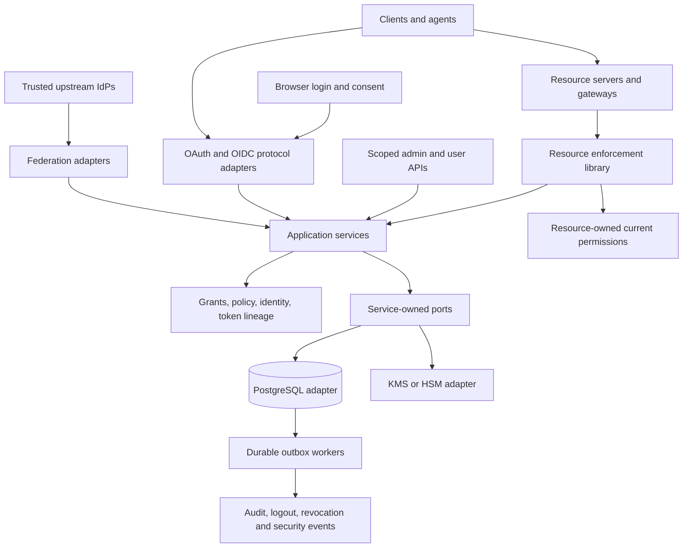

# Mayi Go authorization server implementation plan

October 17, 2026 · Proposed architecture and delivery plan

Build Mayi as a standalone Go authorization server with a durable grant model, explicit tenant boundaries, and a companion resource-server enforcement library. Use an existing Go OAuth and OIDC implementation for protocol machinery. Own the policy, persistence, delegation, revocation, federation, and operational behavior that distinguish this project.

The repository contains [the requirements README](../README.md), architecture documentation, a Go module, CI policy checks and the initial [P0 contract implementation](p0/protocol-spike.md). P0 is in progress: domain/service prototypes, S256 verification and transaction-double tests exist; the protocol server, real storage and production signer are not implemented. Its 156 requirements comprise 110 MUSTs, 35 SHOULDs, and 11 MAYs. [The requirement matrix](requirement-matrix.md) assigns every one a delivery phase, implementation owner, and acceptance condition. Everything in that matrix is planned, not implemented or verified.

[AGENTS.md](../AGENTS.md), the [canonical repository structure](repository-structure.md), and the [dependency policy](dependency-policy.md) govern implementation. Allowed software licenses are MIT, Apache-2.0, 0BSD, BSD-2-Clause, BSD-3-Clause, PostgreSQL, ISC and MPL-2.0. Named libraries remain candidates until their exact versions and transitive dependencies pass admission.

The recommended first release supports all README MUSTs. Earlier milestones are development previews with explicitly smaller capability sets. SHOULDs have scheduled follow-up work; MAYs remain separate optional projects. Do not call a preview README-complete or claim certification from a dependency's certification.

## 1. Decisions to make first

The P0 baseline decisions for issuers, online revocation, grant revisions and gateway exchange are recorded in [ADRs 0001–0004](adr/0001-tenant-issuers.md). Library selection remains open in the [spike report](p0/protocol-spike.md). Record subsequent changes as architecture decisions with consequences and tests.

| Decision | Proposed default | Reason and consequence |
| --- | --- | --- |
| Product boundary | Standalone AS plus Go resource middleware, integration contract, and example BFF/gateway | Several requirements cannot be satisfied by token issuance alone. Non-Go resources need the same enforcement contract. |
| Deployment | Modular monolith, one Go module; API and durable worker roles | Keeps issuance and grant changes transactional without introducing distributed services prematurely. |
| Issuers | Immutable path-based issuer per tenant, such as `https://auth.example/t/{tenant-id}` | Isolates metadata, keys, clients, and upstream trust. Tenant slugs may change; issuer identifiers may not. |
| Storage | PostgreSQL is authoritative; no additional cache in the baseline | Revocation, replay detection, code redemption, and refresh rotation must remain correct across crashes and replicas. Any later cache requires exact-version license admission. |
| Revocation | Online checks for every protected request in the supported strict profile | Local JWT verification and asynchronous invalidation cannot promise immediate revocation. |
| Access tokens | RFC 9068 JWTs, single audience; optional opaque format | Both formats use the same authorization and online revocation decision. JWTs are not implicitly offline credentials. |
| Authentication | Upstream OIDC first; local sessions; step-up delegated to configured capable IdPs | Avoids building password enrollment, recovery, and MFA infrastructure in the first release. Self-hosting can use a local upstream IdP. |
| Grants | Durable root authorization plus immutable permission revisions and issuance ceilings | Consent expansion does not expand credentials already issued. Revoking the root invalidates every revision and descendant. |
| Protocol implementation | Evaluate Fosite first against a fixed acceptance spike; compare ZITADEL OIDC | Select on extension and transaction hooks, not feature counts alone. |
| Drafts | Pinned revisions and fixtures; upgrades are explicit changes | A dependency update must not silently change the public authorization contract. |
| Browser UI | Go-rendered login, consent, connected apps, and initial admin UI | Minimizes first-release frontend and token-storage complexity. |

### Clarifications to the README

Preserve the README as the requirements source. The interpretations below are now resolved by the [P0 capability contracts](../specs/profiles.md); acceptance still requires the relevant implementation tests.

| Requirements | Implementation interpretation |
| --- | --- |
| CORE-3, CORE-4 | Exact redirect matching has the narrowly defined native loopback port exception. It is not a wildcard host or path rule. |
| CORE-5 | Bind codes to the original redirect and authorization transaction. Whether a redirect parameter is required at redemption follows the pinned OAuth version and compatibility profile. Code reuse invalidates its issuance lineage after validating the presenting client's credentials and binding evidence. |
| GRANT-2 | A signed token cannot change when a user's permissions change. Its claims are a ceiling; the resource intersects them with current permissions on each request. Rewrite the literal claim that a token never “carries” lost permissions as an enforcement guarantee. |
| GRANT-9, LIFE-7, OPS-3 | Immediate revocation requires an authoritative online decision. Push and cached positive results provide bounded delay unless a stronger consistency protocol is proved. Do not claim both partition-tolerant offline authorization and immediate revocation. |
| GRANT-12, GRANT-11, FED-5 | Consent may also be replaced by an explicit administrative authorization or a trusted enterprise grant. The first-party-only wording must distinguish interactive consent exemptions from these separate authorization sources. |
| CLI-3 | CIMD proves control of the metadata host, not the publisher's reputation. Same-origin redirect restrictions are Mayi policy, not an unconditional CIMD mandate. Provide reviewed native and approved third-party redirect exceptions. |
| BIND-2 | `ath` is checked when a DPoP proof accompanies an access token at a resource. Ordinary token-endpoint proofs have no access token to hash. |
| BIND-7, DEL-1 | Rebinding during exchange is not automatically specified by combining DPoP and token exchange. Define an authenticated resource-recipient exchange profile and its trust assumptions before enabling this topology. |
| RES-3, RES-4 | Missing resources require an explicit endpoint binding. Multiple authorized resources yield separate access-token responses, one selected resource at a time, not a proprietary array of tokens. |
| RES-7, M2M-4 | `sub == client_id` alone is not a safe discriminator if namespaces can collide. Use disjoint identifiers and an explicit private `principal_type` claim as well. |
| OIDC-1, OIDC-3 | Requiring nonce for code flow is a stricter Mayi profile. The AS echoes the bound nonce; the relying party validates it. `offline_access` requests refresh capability, not a UserInfo claim bundle. |
| OIDC-3, RES-4 | A business-resource access token is not a UserInfo credential. Register UserInfo as a separate resource; use a separately authorized single-audience token or return approved identity claims in the ID token. |
| LIFE-12 | JWTs carry `jti`. Opaque access/refresh tokens and codes have internal issuance IDs and hashed handles; their plaintext need not contain a JWT claim. |
| SEC-10 | FAPI is a complete profile with conformance requirements, not three switches. Public/native clients use the base profile; do not label them FAPI clients. |
| WEB-3, WEB-5 | Browser-dependent behavior is capability-tested. Embedded application pages may be frameable; login and consent remain top-level only. Unsupported embedding fails explicitly rather than leaking tokens into URLs or messages. |
| FED-9 | Enterprise assertions alone do not notify Mayi when upstream access is removed. Immediate upstream cutoff needs authenticated lifecycle signals or an online upstream decision contract. |

The relevant protocol distinctions are covered by [RFC 8252](https://www.rfc-editor.org/rfc/rfc8252), [CIMD](https://datatracker.ietf.org/doc/html/draft-ietf-oauth-client-id-metadata-document-02), [DPoP](https://www.rfc-editor.org/rfc/rfc9449), [token exchange](https://www.rfc-editor.org/rfc/rfc8693), [OIDC Core](https://openid.net/specs/openid-connect-core-1_0.html), and [FAPI 2.0](https://openid.net/specs/fapi-security-profile-2_0-final.html). The stricter choices above are Mayi design decisions.

### Specification baseline

Primary sources checked for this plan show several changes from the README. The [P0 manifest](../specs/manifest.yaml) now records exact URLs, revisions/commits, content hashes, retrieval dates, target sections and deviations. Implemented protocol sections remain empty until adapter evidence exists.

| Dependency | Baseline for the implementation spike |
| --- | --- |
| OAuth 2.1 | Datatracker reports **-16**, updated September 2, 2026; the README says -15. [Source](https://datatracker.ietf.org/doc/draft-ietf-oauth-v2-1/16/) |
| CIMD | **-02**, with explicit Mayi redirect and egress policy. [Source](https://datatracker.ietf.org/doc/html/draft-ietf-oauth-client-id-metadata-document-02) |
| ID-JAG | **-04**. Pin the claim rules, token types, and issuer/client relationships. [Source](https://datatracker.ietf.org/doc/draft-ietf-oauth-identity-assertion-authz-grant/04/) |
| MCP | Pin the **2026-07-28** authorization specification and an exact enterprise extension commit, not a mutable documentation URL. [Release](https://blog.modelcontextprotocol.io/posts/2026-07-28/), [extension](https://modelcontextprotocol.io/extensions/auth/enterprise-managed-authorization) |
| Transaction tokens | Datatracker reports **-11**, rather than README -08; defer implementation to P7 and recheck then. [Source](https://datatracker.ietf.org/doc/draft-ietf-oauth-transaction-tokens/) |
| Browser applications | The RFC Editor identifies **RFC 10017**, published August 2026; remove the README's uncertainty when its references are updated. [Source](https://www.rfc-editor.org/rfc/rfc10017) |
| Other profiles | Pin OIDC specifications, FAPI, SSF/CAEP, DBSC, attestation, and global-revocation documents in the phase that implements them. Do not invent revisions now. |

## 2. Architecture and ownership



Use ports and adapters with dependencies pointing inward. Reusable business orchestration belongs in `internal/services/`; pure entities and invariants belong in `internal/domain/`. Thin routes, jobs and protocol callbacks invoke services. Services authorize before protected payload access, and use consumer-owned ports for persistence and other effects. Concrete adapters are wired only at the composition root. The [canonical layout](repository-structure.md) is authoritative; the summary below does not define a competing structure.

```text
cmd/mayi/                    process startup only
internal/app/                configuration, dependency wiring and lifecycle
internal/domain/             pure identity, client, grant, token and policy rules
internal/services/           reusable use cases, authorization and consumer-owned ports
internal/adapters/inbound/   thin HTTP, protocol, CLI, job and presentation adapters
internal/adapters/outbound/  PostgreSQL, signing, crypto, egress, IdP and event adapters
pkg/resource/                stable resource validation and enforcement API
examples/                    BFF, native client, machine, gateway and MCP resource
tests/                       integration, conformance, adversarial and chaos tests
tools/                       architecture/license checks and versioned evidence
specs/                       pinned normative sources and capability profiles
deploy/                      container, local stack and production deployment
docs/                        plans, canonical structure, policy and architecture decisions
```

The CI baseline pins Go 1.27.0 and uses only its standard library for policy checks. For the server, use `net/http` in inbound adapters and consider PostgreSQL via `pgx` in outbound adapters, with explicit SQL and generated bindings where helpful. Choose a maintained JOSE implementation and telemetry integration after exact-version license and security review. Do not implement signing primitives. CI rejects modules absent from the reviewed inventory; no external server module has been admitted yet.

### Protocol library selection

| Option | Evidence and assessment | Decision |
| --- | --- | --- |
| Ory Fosite | Go OAuth/OIDC SDK with composable handlers and storage integration. Its all-enabled example also includes flows Mayi must refuse. [Repository](https://github.com/ory/fosite) | First spike candidate. Explicitly compose allowed handlers. Prove custom persistence, binding, and extension behavior before committing. |
| ZITADEL OIDC | Go provider/RP library whose feature table includes code, refresh, JWT profile, exchange, device authorization, and back-channel logout; mTLS is listed as not yet supported. [Repository](https://github.com/zitadel/oidc) | Compare against the same fixtures. Prefer it if required hooks substantially reduce custom protocol code. |
| Ory Hydra | Complete Go OAuth/OIDC server with separate login/consent integration. [Repository](https://github.com/ory/hydra) | Benchmark the buy/extend option. Choose only if its supported extension points satisfy lineage and revocation requirements without a permanent broad fork. |
| New protocol engine | Maximum control, but the project owns every parser, edge case, and interoperability bug | Do not choose by default. A rejected library requires a written gap assessment before custom protocol work. |

Timebox P0 to a roughly two-week engineering spike. Exercise authorization code plus S256, one-resource tokens, refresh race/reuse, immutable grant correlation, KMS signing, private-key client authentication, DPoP hooks, token exchange, and basic OIDC. Compare transaction ownership, not just successful HTTP responses. Record exact versions and native/configured/custom/unsupported classifications. No library is assumed to satisfy the complete README.

## 3. Persistent model and invariants

Tenant scope belongs in every ownership key and query. Use composite foreign keys such as `(tenant_id, grant_id)`, uniqueness constraints, and PostgreSQL row-level security as defense in depth with a non-bypass application role. Jobs, migrations, backups, and admin paths need explicit isolation tests too.

| Record | Important contents and behavior |
| --- | --- |
| `tenants`, `issuers`, `tenant_policies` | Immutable issuer, region, policy version, key references, capability profile and tenant revocation epoch. |
| `users`, `memberships`, `external_identities` | Local user, active tenant membership, user epoch; unique tenant/provider/issuer/upstream-subject link. No automatic email linking. |
| `clients`, `client_credentials`, `client_metadata_versions` | Registration source, public/confidential classification, redirects, authentication methods, approved resources, client epoch, hashed secrets, key references and fetched metadata digest. |
| `resources`, `resource_scopes` | Exact URI, owner tenant, descriptions, token profile, binding requirement, lifetime and authorized callers. |
| `authorization_transactions` | Validated request snapshot, tenant, issuer, client metadata version, resource ceilings, PKCE, nonce, state, session, return location, expiry and consumed status. |
| `authorizations`, `grant_revisions` | Root revocable authorization, principal type, source of authority, user/client/resource, permission revisions, validity, approval evidence and policy version. One user grant per resource. |
| `admin_authorizations` | Tenant-wide policy approval with explicit target clients/resources/scopes and an epoch referenced by resulting per-user grants. It does not create user permissions. |
| `authorization_codes` | Hashed code, transaction, exact grant revision, client, PKCE, optional DPoP thumbprint, expiry, consumed time and issuance lineage. |
| `refresh_families`, `refresh_tokens` | Root grants and immutable resource/scope ceilings, binding, hashed token, predecessor/successor, consumed status, idle/absolute deadlines and family revocation. |
| `token_issuances`, `token_ancestors` | Internal ID/JWT `jti`, token kind, subject, presenter, audience, ceiling, binding, root grant/revision, code, family, parent, bounded ancestry, epochs and expiry. |
| `delegation_edges` | Allowed receiving resource, intermediary client, downstream resource, scope/RAR attenuation rule, depth and lifetime ceiling; versioned and revocable. |
| `browser_sessions`, `rp_sessions` | Hashed session handle, membership, authentication evidence, idle/absolute expiry; RP client, logout destination and session identifier. |
| `trusted_assertion_issuers` | Per-tenant trust, accepted token purposes and audiences, permitted clients/subjects/resources, key source, assurance mappings and provisioning policy. |
| `replay_entries` | Unique issuer/client/assertion ID or resource/key/proof ID, protocol namespace and expiry. Authoritative atomic insert. |
| `keys`, `audit_events`, `outbox_events` | Public key metadata and non-exportable signer reference; append-only decision records; durable, retryable delivery. |

Index hot lookups by tenant plus token hash/ID, grants by tenant/user/client/resource, active families, ancestor token IDs, expiry, and pending outbox delivery. Bound ancestry to prevent unbounded recursive work. Partition high-volume issuance, replay, and audit records by time only after measuring volume and preserving tenant constraints.

The core invariants are:

1. An access token belongs to exactly one issuer, tenant, principal, resource and authority root.
2. Issued permissions are contained in the validated request, original credential ceiling, current grant, tenant policy, and resource/client policy. For delegation, apply a reviewed attenuation map before comparing resource-specific permissions.
3. Access-token `exp` is capped by grant and policy deadlines, the refresh-family absolute deadline when applicable, and the subject-token expiry for delegated exchange. Code and assertion expiry normally limit their redemption window; resulting token and grant lifetimes follow the specific grant profile. Refresh cannot extend the absolute lifetime of its family.
4. Login establishes identity. Authorization establishes permission. An upstream identity assertion never becomes unrestricted authorization merely because its signature verifies.
5. Consuming a code or refresh token, recording successor credentials and lineage, and committing issuance audit evidence is one atomic state transition.
6. Every token response refers to the exact authorization transaction and grant revision that approved it. Never find “the latest grant for this user/client.”
7. Every externally accepted token kind has a distinct validator and purpose. An ID token, assertion, logout token, and access token are not interchangeable.
8. All derived tokens retain their revocation dependencies, including relevant intermediary client and administrative-policy epochs.

## 4. Authorization and credential flows

### Interactive authorization

Resolve the configured issuer from a trusted route, not arbitrary Host or forwarded headers. Resolve and validate the client before choosing any redirect. Validate resource, scopes, response type, PKCE, and OIDC parameters; reject unknown values rather than silently granting defaults.

Persist a short-lived authorization transaction before login. On callback, validate upstream state, nonce, issuer, audience and PKCE, then map the upstream identity and verify tenant membership. Account selection cannot switch the tenant of an existing transaction. Start a new transaction if the user chooses a different tenant.

Consent renders escaped client metadata with the verified metadata host, redirect destination, resource and human scope descriptions. Do not embed arbitrary remote logos or HTML. The approval POST uses CSRF protection and a one-use transaction handle, then rechecks membership, policy and client metadata before committing a grant revision and a code.

At redemption, authenticate the client as applicable, validate PKCE and binding, and atomically consume the code. Codes expire within 60 seconds. Refuse implicit/password grants and avoid registering their handlers at all. Invalid client or redirect errors stay on Mayi; validated redirect errors use the selected protocol's error contract.

An incremental approval creates a new immutable revision while the UI presents the union of approved permissions. Existing refresh families retain their original ceilings. Newly approved access requires credentials issued from the new authorization transaction.

### Resource selection and OIDC

Use one canonical issuer per tenant. The normal authorize endpoint requires `resource` for business API access. A resource-specific route such as `/t/{tenant}/r/{resource-id}/authorize` supplies a server-owned fallback binding for older clients. Persist that binding through code redemption and refresh; reject a conflicting resource parameter. Publish and test the endpoint variant used by each compatibility profile.

For an OIDC-only login, the configured default protected resource is UserInfo, never a generic business API. OIDC identity scopes are handled separately from resource-local API scopes. If multiple resources are authorized in one interaction, record distinct resource grants and an explicitly bounded refresh authorization set. Redemption returns one selected access token; subsequent refresh calls select another previously authorized resource. Concurrent multi-resource refresh still follows one serialized rotation chain.

Generate ID tokens for the relying client, with the bound nonce and approved authentication/identity claims. UserInfo validates a token intended for UserInfo and releases only permitted claims. Add a pairwise subject mapping later without changing the stable internal user identity.

### Refresh and replay

Store opaque random refresh tokens as keyed hashes with hash-key versions. Retain consumed-token records for the family's relevant replay-detection period; deleting them immediately makes reuse look like an unknown token.

Use row locking or a compare-and-swap transition so two redemptions cannot both succeed. Validate client and sender binding before treating a presentation as authenticated reuse. Under the README's strict rule, reuse revokes the family and root grant, including access and exchanged tokens. This means duplicate legitimate retries can require reauthorization. Document client-side serialization and do not add a silent grace period.

Signing can happen before the final state transaction if it uses a candidate issuance record. Before commit, recheck and lock relevant versions, grant state, credential status and deadlines in a deterministic order. Do not return signed bytes until consumption, issuance and audit commit. A signing failure must not consume a credential; a committed response lost in transit follows the documented replay policy.

### Machine tokens and JWT assertions

Client credentials uses its own authority root and resource allowlist. It issues no refresh token by default and no user identity claims. Assign each workload or autonomous agent a separate registered identity.

Keep three assertion uses distinct: client authentication, authorization grant, and federated subject exchange. A JWT accepted for one use is not accepted for the others by default. Validate an explicit trusted issuer/key source, audience, time bounds, purpose, subject mapping and atomic replay entry. Never follow a JWT-controlled `jku` or `x5u`.

Later workload adapters must specify provider-specific proof formats and audiences. Kubernetes, Google/Azure identity tokens and SPIFFE JWT-SVIDs are not interchangeable. AWS workload authentication may require a separate signed-request or identity-broker adapter; do not assume an arbitrary AWS credential is an RFC 7523 JWT assertion.

## 5. Revocation and resource enforcement

Define immediate revocation precisely: once the revocation transaction commits, any new authorization decision that begins afterward rejects the affected credential. Already authorized in-flight operations cannot be recalled. Long-running or high-impact operations recheck at an appropriate transaction boundary; streams periodically reauthorize and close on revocation.

The resource SDK performs cryptographic/type validation, exact issuer/audience/tenant matching, token expiration, required sender binding, current token/grant/ancestor/epoch status, then resource-owned current permission checks. A valid token is necessary but does not grant access to every object in its audience.

| Mode | Mechanics | Guarantee |
| --- | --- | --- |
| Strict, supported default | Online introspection or grant-status decision for every request, using authoritative state; no stale positive cache | Meets the defined immediate-revocation contract, at an availability and latency cost. |
| Offline or bounded-cache, possible future exception | JWT verification plus cached status and invalidation events | Does not meet the README's immediate-revocation MUST. Requires an explicit requirements change; exclude from compliant deployments. |

Introspection authenticates a registered resource server and authorizes it to inspect tokens for its own audience and tenant. Return inactive without leaking foreign token claims. Introspection reports token validity and ceilings; it cannot evaluate an object ACL without an object and action. The resource's permission adapter makes that final decision.

Revoking a root grant marks it inactive and commits an audit/outbox event. Checks consult that root, so security does not wait for recursively rewriting every descendant row. Also check individual-token/ancestor revocations, family revocations and user/client/tenant/admin/delegation epochs. An authenticated token-revocation request affects only credentials the caller is allowed to revoke; unknown tokens receive the standard non-disclosing response.

Signed revocation events, denylist publication and later CAEP improve propagation and stream shutdown. Use unique event IDs, ordering/version guards, retry, durable checkpoints and periodic reconciliation. Security is based on authoritative state even if a worker is delayed.

Target the README's regional p99 below 10 ms with indexed compact status queries, connection pools, short network paths and load testing. Do not promise the target before measurement or use stale read replicas to reach it. If PostgreSQL cannot meet load, design a strongly consistent regional status service as a measured follow-up. Loss of authoritative state fails closed for protected operations.

## 6. Sender binding and delegation

Implement a shared DPoP validator used by the token endpoint and resource SDK with endpoint-specific rules. Check proof type, asymmetric signature, public JWK thumbprint, algorithm allowlist, method, target URI, time window, and atomic replay prevention. Resource access also validates `ath` and equality with the token's `cnf.jkt`. A bound token cannot be downgraded to bearer use.

Reconstruct public target URLs only through configured trusted proxies. Test ports, percent encoding, path handling, query exclusion and reverse-proxy rewriting against RFC 9449. Nonces and `dpop_jkt` are recommended early hardening. Refresh proofs must match the family's binding; key loss requires reauthorization unless a separately reviewed key-change protocol exists.

For multiple API replicas, a best-effort local replay cache is insufficient. Start with an authoritative unique insert with expiry. Any replacement store must pass license admission and have a documented no-replay failover guarantee, or fail closed during uncertain state. mTLS later follows the same binding interface, with trusted certificate termination and authenticated forwarding only.

### Gateway exchange profile

An incoming token has the gateway as its audience and remains bound to the caller's key. The caller proves possession to that gateway. The gateway authenticates as a confidential client to Mayi and proves possession of its own outgoing DPoP key. It requests an exchange to an explicitly allowed downstream resource.

Mayi verifies the subject token's issuer, intended recipient, current root and lineage, then checks that the authenticated gateway owns that receiving-resource role and is permitted by `may_act` or a configured delegation edge. It authorizes recipient-driven exchange only for this topology. It must not accept arbitrary tokens solely because the intermediary knows their bytes. If an actor token is supplied, bind it to the authenticated intermediary and validate its permitted purpose.

The gateway is trusted to enforce the original caller's proof. Its client authentication is not proof of possession of the caller's DPoP key. An original proof for the gateway URI must not be reinterpreted as a token-endpoint proof. Document this trust explicitly, test it with a real gateway, and require external security review before production. Other exchange topologies remain disabled until they have a reviewed sender-binding contract.

The output retains the original internal subject and tenant, records the current actor outside prior actors in `act`, and binds to the gateway's new key. Prior `act` entries are audit history, not additional independent authorization. Enforce maximum depth, no cycles, target allowlist, bounded lifetime and monotonic permissions. Cross-resource scope strings require typed, reviewed attenuation maps; identical names do not imply identical privileges.

Record every parent and relevant actor dependency. Do not issue refresh tokens from ordinary gateway exchange. A gateway cannot extend the incoming credential's lifetime by repeatedly exchanging it, erase its ancestors, or exchange a token intended for a different gateway.

## 7. Unknown clients and safe network access

All untrusted metadata fetching uses one hardened egress component: CIMD, remote JWKS, upstream discovery, later federation metadata, and configured callback delivery with destination-specific policies.

For public metadata, require HTTPS, reject credentials/fragments where prohibited, bound response size and time, resolve all addresses, and reject loopback, private, link-local, multicast, reserved, IPv4-mapped and metadata-service destinations. Enforce the check on the actual socket connection to prevent DNS rebinding. Disallow redirects by default; any permitted same-host redirect repeats all checks. Validate content type and parse size/depth limits.

Private enterprise endpoints need a separate admin-approved egress policy; a client cannot opt into it. Air-gapped deployments use pre-registered or mirrored approved metadata and local IdPs. Do not turn off SSRF protection to make internal endpoints work.

CIMD resolution validates exact client identifier, permitted metadata, redirects and authentication keys. Honor cache directives within security limits, including `no-store`; support conditional fetches. Keep authorization transactions tied to the validated metadata digest. If security-sensitive metadata changes before approval/redemption, reject or restart rather than silently redirecting to a new destination. Metadata fetch failure cannot widen trust.

DCR validates the same metadata, enforces registration quotas and tenant policy, and can require an initial access token. Dynamically registered public clients remain public. Do not treat possession of a public URL or self-declared software name as confidential authentication. Registration-management tokens are separately scoped and hashed.

For `private_key_jwt`, validate client identity, audience, bounded time and replay ID using registered keys. For legacy client secrets, generate high-entropy values server-side, display once, store only a versioned hash, and support bounded overlap and expiry.

## 8. Federation and enterprise control

Upstream OIDC adapters establish local identity through a configured tenant provider. Home-realm hints are routing suggestions, not proof of membership. Link accounts only through an authenticated, explicit workflow; never merge users by matching email addresses. Map assurance levels per trusted provider rather than treating all `acr` strings as equivalent. Step-up succeeds only after validating the returned authentication time and assurance evidence; requesting `max_age` or `acr_values` alone does not establish compliance.

ID-JAG acceptance is a separate authorization adapter with a pinned draft profile. It validates issuer trust, signature, type, AS audience, authenticated client relationship, replay ID, time bounds and local tenant subject. Resolve requested resources and permissions against local policy and any assertion ceilings. Mayi's stricter profile requires an explicit target and permission ceiling even where the draft permits omissions. Record a local enterprise-derived grant so resulting credentials participate in ordinary revocation and audit.

Only enable no-prompt access when the tenant has authorized that issuer/client/resource relationship. ID-JAG does not grant a user permissions they lack at the resource. Keep its assertion validator separate from generic JWT bearer grants. See the [ID-JAG profile](https://datatracker.ietf.org/doc/draft-ietf-oauth-identity-assertion-authz-grant/04/).

MCP enterprise support includes the pinned extension's discovery and grant-profile metadata, a real resource challenge, and a complete client-to-IdP-to-Mayi-to-resource fixture. An ID-JAG endpoint by itself is not MCP conformance. The [extension documentation](https://modelcontextprotocol.io/extensions/auth/enterprise-managed-authorization) defines that wider interaction.

For upstream deprovisioning and policy removal, provide a scoped lifecycle integration in P5 that revokes membership, sessions, grants and relevant policy epochs. Require the enterprise integration to deliver authenticated events or online status decisions for central cutoff. Later SCIM and SSF/CAEP adapters drive the same internal commands. Define the guarantee from event receipt; upstream delivery delay must be separately measured and reported.

Issuing ID-JAGs, accepting generic upstream subject tokens, SAML login and SCIM are P7 extensions. Each has explicit trust, replay, audience and subject mapping rules. In particular, accepting arbitrary upstream access tokens without an intended-recipient trust contract would create a token laundering endpoint.

## 9. Browser sessions and administration

Mayi's login cookie is a random server-side session handle with `__Host-`, Secure, HttpOnly, Path `/`, and an appropriate SameSite policy. Rotate handles at authentication and privilege transitions. Validate transaction state on cross-site IdP returns; a signed SAML POST, when added, needs its own tested cookie/correlation handling.

First-party apps use the supplied BFF pattern. The browser holds its session cookie; encrypted upstream refresh/access credentials remain server-side. Cookies are not authorization for tenant admin operations on their own: the BFF holds a resource-scoped admin token and enforces CSRF and fresh step-up.

Apply a nonce-based CSP, Trusted Types where supported, no-referrer, no-store on sensitive responses, request/body limits and CSRF checks. Login and consent always use `frame-ancestors 'none'`. Embedded application pages get explicit tenant frame/origin policies, partitioned cookies where supported and a tested Storage Access fallback. An origin-checked one-use code is bound to the intended session/client and expires quickly; never post an access or refresh token. WebSockets use equivalent single-use tickets.

Implement login, consent, tenant/account selection, step-up, sessions and connected-apps screens. Admin API/UI manages clients, resources, scope descriptions, grants, policies, IdPs and key lifecycle. Authorize actions through separate admin scopes and tenant roles; reauthenticate for policy widening, key changes and broad revocation. Client metadata and redirect changes are audited security changes.

RP-initiated logout validates registered return destinations. Back-channel logout uses signed, purpose-specific tokens and a durable per-RP delivery queue with retry and replay-safe receivers. Ending a local session and revoking application grants are distinct operations; offer an explicit “sign out everywhere and revoke access” action. Do not silently imply that logout recalls every independently authorized API token.

For browsers that must hold tokens, provide a short-lived DPoP integration example with a non-exportable WebCrypto key. Key possession reduces remote replay but does not prevent malicious script in the same origin from using it. DBSC and device anomaly detection are later additional protections, not substitutes for these controls.

## 10. Endpoint and integration contracts

Let `I = https://auth.example/t/{tenant-id}`. Endpoints derive from configured issuer records; metadata derives from enabled, tested capabilities.

| Surface | Contract |
| --- | --- |
| OAuth discovery | `https://auth.example/.well-known/oauth-authorization-server/t/{tenant-id}` for RFC 8414 path insertion. |
| OIDC discovery | `I/.well-known/openid-configuration`; return the same issuer and compatible endpoints/capabilities. |
| OAuth | `I/authorize`, `I/token`, `I/revoke`, `I/introspect`, `I/jwks`; resource-bound authorize variant as described above. |
| Client registration | `I/register`; optional per-client registration management endpoint with its own credential. |
| OIDC | `I/userinfo`, `I/logout`; configured RP back-channel destinations. |
| Later grants | `I/device_authorization`, browser verification page, and `I/par`, only advertised when enforced. |
| Protected resources | Resource-owned RFC 9728 metadata and authenticated API; SDK supplies correct challenges with metadata URL. Mayi manages the underlying resource catalog. |
| Self-service | `/api/v1/me/grants`, `/api/v1/me/sessions` and narrow revoke operations. |
| Tenant administration | `/api/v1/tenants/{tenant-id}/...` protected as a registered administrative resource, with object authorization and step-up. |
| Internal enforcement | Authenticated introspection and, if needed, a private versioned status API; no unauthenticated token/grant existence oracle. |

The different discovery-path conventions require dedicated tests; see [RFC 8414](https://www.rfc-editor.org/rfc/rfc8414). Errors are endpoint-specific: OAuth JSON at the token endpoint, safe authorization error redirects only after redirect validation, and resource challenges at resource endpoints. Include `scope`, `resource_metadata`, and step-up details where appropriate rather than copying one universal error shape everywhere.

Define `pkg/resource` around a validator, an authoritative status checker, and a resource-owned permission checker. Return typed principal, tenant, audience, granted ceiling, authentication context and actor history to application handlers. Provide interoperability fixtures for non-Go services; do not require them to trust unsigned identity headers from a gateway.

## 11. Operations and failure behavior

Run API replicas across zones with an HA PostgreSQL deployment, a region-local KMS/HSM, and redundant workers. Choose synchronous replication and failover behavior that does not resurrect acknowledged revocations or consumed credentials. Begin with a single writer region per tenant; route tenant traffic, user data and audit storage according to residency. Defer active-active multi-region writes until there is a proven consistency design.

Use ES256 as the proposed first signing algorithm if the chosen KMS supports it and clients interoperate. Keep algorithm policy configurable for PS256/EdDSA after tested support. Private signing keys never leave the KMS/HSM in production. Separate access/ID/assertion/logout token purposes even if a deployment shares key infrastructure. Development-only generated keys must be impossible to enable accidentally in production.

Publish a new key before signing with it and allow cache propagation. Keep old public keys until all artifacts they signed have expired, including allowed skew/cache overlap. Emergency compromise removes trust and revokes affected credentials; that intentionally differs from routine rollover. Validate KMS signing quotas, latency and zone behavior early.

| Failure | Required behavior |
| --- | --- |
| PostgreSQL/status unavailable | Refuse issuance and protected authorization; do not fall back to offline allow. |
| KMS unavailable | Stop new issuance; existing tokens remain verifiable while status checks work. Serve cached public JWKS through redundant infrastructure. |
| Replay service uncertain | Fail closed for operations that require replay protection. |
| Audit exporter unavailable | Continue only while the durable audit/outbox write succeeds and backlog remains within operational limits. Never silently lose successful issuance events. |
| Upstream IdP unavailable | Fail new login/step-up; existing local credentials follow their explicit validity and lifecycle policy. |
| Metadata/JWKS refresh unavailable | Use only still-valid approved cache entries under policy; unknown keys and expired metadata fail closed. |
| Logout/revocation delivery delayed | Authoritative local revocation still works; alert and retry external delivery. |
| Backup restore | Invalidate potentially resurrected credentials using a recovery epoch outside the rollback domain, or rotate affected issuer trust and require reauthorization before reopening traffic. |

Use an outbox in the same transaction as successful security-sensitive changes. Persist rejected security decisions separately without recording tokens, codes, assertions, cookies or unnecessary identity claims. Redact HTTP bodies/headers in proxies and telemetry. Restrict audit access and apply tenant retention policies. Later add externally anchored digests or immutable storage for tamper evidence; an unanchored hash chain alone is insufficient against database replacement.

Export latency, error rate, issuance volume, refresh replay, proof replay, inactive-token use, grant-check failures, key failures, and outbox lag. Keep tokens, user IDs and unbounded client IDs out of metric labels. Deliver restore, emergency revoke, compromise, KMS outage, migration and zone-failure runbooks. Migrations use expand/backfill/contract with mixed-version integration tests.

## 12. Verification strategy

Every MUST receives a positive and negative integration case where applicable, linked to its requirement ID. Keep protocol correctness, policy correctness and operational guarantees separately visible.

| Suite | Cases that determine readiness |
| --- | --- |
| Protocol | S256-only, missing/malformed parameters, duplicate parameters, native redirect exceptions, issuer mix-up, safe error redirects, JWT purpose confusion, exact discovery behavior. |
| Transaction concurrency | Concurrent code redemption; refresh reuse and lost responses; revocation racing issuance/exchange; consent expansion racing refresh; crash before/after commit; replica failover. |
| Tenancy | Every resource, grant, client, session, key, admin path and async job tested with foreign tenant IDs and valid foreign credentials. |
| Resource enforcement | Token for resource A refused at B; wrong tenant/object; user loses access while token remains signed and unexpired; strict status outage; UserInfo versus API audience separation. |
| Delegation | Multi-hop narrowing, illegal scope maps, depth/cycle limits, actor substitution, foreign recipient exchange, root/parent/actor revocation, copied bound tokens and unavailable original key. |
| Network abuse | DNS rebinding, mixed public/private DNS answers, redirect chains, IPv6/mapped addresses, metadata services, huge/slow documents, malicious logos and JWT key URLs. |
| Federation | Assertion replay, wrong issuer/audience/client/type, unlinked subjects, email collisions, deprovisioned users, untrusted assurance, ID-JAG ceiling violations. |
| Browser | CSRF, clickjacking, malicious client metadata, session fixation, origin-checked messages, unsupported cookie/iframe behavior, logout replay and BFF token leakage. |
| Conformance | Applicable OpenID OP plans, FAPI plan once enabled, and pinned MCP authorization/enterprise tests; validate complete deployments, not isolated library examples. |
| Performance and recovery | Regional p50/p95/p99, database contention, signing throughput, hot tenants, worker backlogs, key rotation, zone loss, backup restore and long-running connection revocation. |

Use real PostgreSQL integration tests, deterministic clocks, property tests for permission attenuation, Go race detection, parser/URL/JWT fuzzing, dependency vulnerability scans, and containerized conformance infrastructure. Run fast tests on PRs and stateful/conformance suites on trusted CI jobs; retain test artifacts and spec revisions. If an upstream MCP conformance runner does not cover a pinned requirement, supply protocol fixtures and document that gap rather than claiming coverage.

Before production, publish the threat model and commission an independent review of grant correlation, replay races, tenant isolation, the gateway exchange profile, assertion trust, browser flows and recovery. Track findings to remediation and retest. No successful demo substitutes for this gate.

## 13. Delivery sequence

Engineering ranges below are planning estimates for a team of three experienced Go/identity engineers, with dedicated frontend/platform support and recurring security review. They are not a delivery commitment. Re-estimate after P0 using measured library gaps and the deployment environment. A solo implementation should expect substantially longer elapsed time.

| Phase | Work and outputs | Exit condition | Indicative elapsed effort |
| --- | --- | --- | --- |
| P0 Architecture and protocol spike | Resolve interpretations; pin specs; library and license-graph comparison; threat model; issuer/revocation/exchange ADRs; transaction/signing prototype | Demonstrate binding/lineage hooks and compliant dependencies, or document why a candidate cannot support them | 2 weeks |
| P1 Tenant and persistence foundation | Go service, local stack, migrations, tenant/issuer/resource/client model, signer, JWKS/discovery, policy API, audit/outbox, CI | Two isolated tenants, tested KMS contract, transactional storage and stable discovery | 2–3 weeks |
| P2 Core authorization preview | Upstream OIDC login, sessions, code/PKCE, consent, immutable grants, JWT/opaque tokens, refresh rotation, introspection/revocation, resource middleware, machine credentials, connected apps | A BFF and resource prove consent, current permissions, rotation and immediate cutoff | 4–6 weeks |
| P3 Agent and unknown-client preview | CIMD, DCR, DPoP, native callbacks, resource metadata, secure egress, client policy and browser-held-token example | Unknown permitted agent connects; copied token and forbidden metadata/redirects fail | 3–5 weeks |
| P4 Delegation | RFC 8693 adapter, approved gateway profile, actor chains, attenuation maps, parent/root revocation and replay tests | Two gateway hops preserve subject and narrow access; all cascade cases pass | 3–4 weeks |
| P5 Enterprise and identity completion | ID-JAG, generic assertions, MCP enterprise integration, upstream lifecycle cutoff, complete OIDC prompt/claims/logout behavior, step-up, admin UI, secure embedding | Required enterprise, OIDC, browser and administration MUSTs pass end to end | 4–6 weeks |
| P6 Production gate | Complete remaining MUST evidence, multi-zone deployment, benchmarks, recovery, security review/remediation, conformance and runbooks | All 110 MUSTs pass or the release is explicitly blocked; no unresolved critical/high security findings | 3–5 weeks |
| P7 Recommended extensions | Device flow, PAR, RAR, mTLS, admin consent, pairwise subjects, SCIM/SAML, workload adapters, signals, FAPI, residency/air-gap hardening, certification and remaining SHOULDs | Each capability is enabled only with its own conformance and operations evidence | Prioritize after P0; roughly another 2–4+ months |
| P8 Optional profiles | CIBA, software statements, attestation, signed metadata/introspection, JAR/JARM, client grant management, front-channel logout and OpenID Federation | Separate design, security review, demand and compatibility case for each | Not included in first-release estimate |

P0 through P6 totals roughly **21–31 weeks** if followed sequentially, or about **5–8 months** including some coordination overhead. Some work can overlap after interfaces stabilize, but security review, interoperability surprises and KMS/IdP integration can extend the range. The first useful limited preview is P2; it is not a production-complete OAuth/agent platform.

Treat keys, observability, audit, tenant isolation and negative tests as part of each phase, even when P6 carries their final production gate. Readiness is evidence-based rather than a deadline-driven checkbox.

### First implementation backlog

1. **Pin the contract.** Add `specs/manifest.yaml`, the threat model, capability profiles, and ADRs for tenant issuers, online revocation, grant revisions, and gateway binding. Resolve the interpretation table.
2. **Choose the protocol adapter.** Run the same fixed P0 fixtures against Fosite and ZITADEL OIDC. Produce a versioned gap report and select one.
3. **Create the service skeleton.** Extend the existing minimal Go module and CI checks with composition, services, adapters, configuration validation, HTTP limits, health/readiness endpoints, reviewed local PostgreSQL and migrations.
4. **Implement storage invariants.** Add tenant keys, authorization roots/revisions, transaction-bound codes, families, lineage, replay entries and transactional outbox.
5. **Integrate the signer.** Prove real KMS signing, public-key conversion/JWKS, overlap rotation and failure behavior.
6. **Build one vertical flow.** One tenant, one pre-registered client, one upstream IdP, one resource, S256, visible consent, code redemption and middleware enforcement.
7. **Prove revocation.** Revoke the grant while its access token is unexpired; the next fresh resource decision must fail. Repeat during concurrent refresh and exchange prototypes.
8. **Prove isolation and current permissions.** Add a second tenant/resource, remove a user's object permission, and demonstrate rejection without waiting for token expiration.
9. **Add the user controls.** Connected apps, scope descriptions, session list, revoke and sign-out behavior with audit evidence.
10. **Publish the preview evidence.** A scripted demonstration plus requirement-linked test results and an accurate enabled-capability list.

### Decisions that can change scope materially

The plan assumes a standalone service that can use upstream IdPs for initial authentication, strict regional online authorization, and ownership of a companion resource integration. Before committing delivery dates, decide whether Mayi must also own user enrollment/password recovery, which deployment/KMS ships first, expected token and resource-check volume, data-retention/residency obligations, and the first two real MCP clients and enterprise IdPs to interoperate with. These decisions affect effort; none prevents starting P0.
